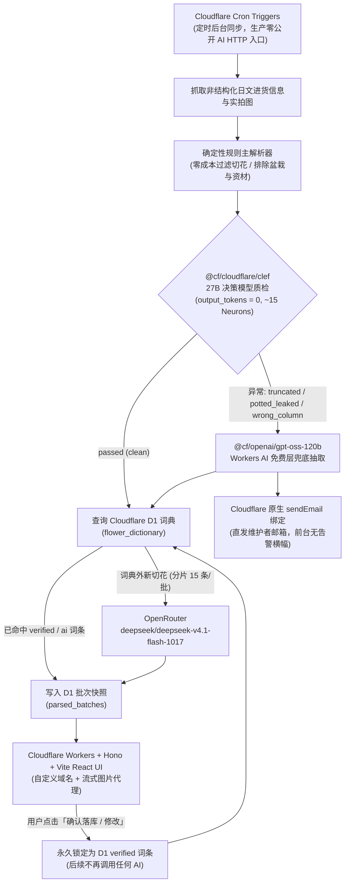

# 朝花手帖 · Cut-Flower Arrival Notes

一个跑在 **Cloudflare 全家桶免费层** 上的切花到货追踪与日文花名整理 Web 应用。

本项目重点探索了一套**低成本、高可靠、零前端打扰的混合 AI 工程架构**：
用确定性规则承担日常 99% 的解析，用 Cloudflare 原生 27B 决策模型 **`@cf/cloudflare/clef`** 做毫秒级质量守门，用 **`@cf/openai/gpt-oss-120b`** 与 **Cloudflare Email Sending** 做无感兜底与运维告警，最后由 **OpenRouter + `deepseek/deepseek-v4.1-flash-1017`** 配合 **D1 永久词典**完成日文花市行话的精准中英文整理。

---

## 架构总览



---

## 核心技术实践

### 1. 用 `@cf/cloudflare/clef`（27B 决策模型）给解析器当「守门员」

非结构化文本解析最大的痛点不是写不出正则，而是**格式某天静默变了却没人知道**，或者把不该进来的盆栽/杂项漏进前台。传统做法是用生成式 LLM 做 LLM-as-a-Judge，但往往慢、贵、还容易输出格式漂移。

我们把 Cloudflare 原生决策模型 **`@cf/cloudflare/clef`** 接进了生产链路（见 `src/worker/fallbackParser.ts`）：

- **只做决策，不生成废话**：Clef 支持结构化 `noul`（概率评分）和 `choice`（多选归因），**`output_tokens = 0`**，单次质检仅消耗约 15 Neurons、耗时 < 1 秒，完全落在 Workers AI 免费额度内。
- **三问联审**：将原文首尾样本与规则解析摘要（条数、首尾花名）送入 Clef，同时评估：
  1. `parse_complete` (`noul`)：切花区是否完整提取，有没有提前截断？
  2. `potted_clean` (`noul`)：结果是否纯净，有没有混入盆栽/花苗/寸/ポット？
  3. `issue_type` (`choice`)：精准归因为 `clean` / `truncated` / `potted_leaked` / `wrong_column`。
- **实测区分度**：正常解析样本的置信度在 **`0.89 ~ 0.95`**，人工构造截断或混入盆栽的坏样本直接跌到 **`0.017 ~ 0.018`**，几乎零误报。

### 2. 把 Cloudflare 全家桶用透（全栈零外置服务器）

整个应用通过 Cloudflare 新一代 **`cf` CLI + 强类型 `cloudflare.config.ts`** 一体化编排，全部能力运行在 Cloudflare 边缘网络：

| Cloudflare 能力 | 在本项目中的角色 | 工程细节 |
| --- | --- | --- |
| **`cf` CLI + `cloudflare.config.ts`** | 强类型基础设施声明 | 用 `defineConfig`、`bindings.*`、`triggers.scheduled` 统一管理所有绑定与环境差异（本地开发不挂载远端 AI，生产自动开启） |
| **Workers + `@cloudflare/vite-plugin`** | 前后端一体化边缘服务 | Vite 8 + React 19 静态资源与 Hono API Worker 同仓构建、单命令部署，开启自定义域名并关闭 `workers.dev` |
| **Workers AI（双模型分工）** | 免费层质检 + 兜底 | `@cf/cloudflare/clef` 负责每次解析质检；仅异常时唤醒 `@cf/openai/gpt-oss-120b`（Responses API、`reasoning.effort: 'low'`）抽取切花救场 |
| **Native Email Sending (`bindings.sendEmail`)** | 静默运维告警 | 解析异常触发兜底时，Worker 直接调用 `env.EMAIL.send()` 发送含诊断原因与原文片段的告警邮件，**不在用户前台弹错误横幅** |
| **D1（APAC）** | 持久化词典与快照库 | 存储 `flower_dictionary`（人机协同词典）、`parsed_batches`（批次快照）、`fetch_cache` 与 `parser_alerts` |
| **Cron Triggers** | 定时抓取与增量翻译 | 精简合并为 3 条 Cron 表达式（适配 Workers Free 单账号 5 条 Cron 上限），按周期高频刷新 + 每日兜底巡检 |
| **Observability & 流式代理** | 可观测性与媒体转发 | 开启 Worker Traces；图片路由严格白名单校验并流式透传响应体，避免 Worker 内存缓冲压力 |

### 3. OpenRouter + DeepSeek V4.1 Flash：89 种真实切花的双盲选型

日文切花名称充满**半角片假名、花市缩写与品种行话**（如 `SPﾊﾞﾗ`、`ﾄﾙｺｷｷｮｳ`、复合品种名等），通用翻译经常直译翻车。我们没有拍脑袋选模型，而是拿 **89 条真实切花数据**搭了本地评测流水线 + **双盲网页人工盲选** + 裁判复核，横向对比了多家 Workers AI 免费模型与 OpenRouter 模型：

| 模型 / 渠道 | 实测结论 | 在架构中的去留 |
| --- | --- | --- |
| **`@cf/cloudflare/clef`** (Workers AI) | 极快（<1s）、0 输出 token、好坏样本概率分离度极高 | **留用：解析器质检裁判** |
| **`@cf/openai/gpt-oss-120b`** (Workers AI) | 0 超时、严格 JSON、长文本抽取稳健；但花艺中文译名偏直译 | **留用：规则失效时的切花抽取兜底** |
| **`@cf/google/gemma-4-26b-a4b-it`** (Workers AI) | 容易把冷门品种幻觉改写，偶尔混入非中日英乱码字符 | 淘汰 |
| **`@cf/qwen/qwen3.8-27b`** (Workers AI) | 思维链偶发泄漏进 JSON `zhName` 字段，15 条批量易超时 | 淘汰 |
| **OpenRouter `:free` 共享免费池** | 极易触发 `429 rpm_limit_exceeded` 或长耗时挂起，Cron 不可靠 | 淘汰 |
| **`deepseek/deepseek-v4.1-flash-1017`** (OpenRouter) | **人工盲选 + 89 题全量复核双冠军**：花市缩写清洗与中文花艺译名最地道；全量 89 条新花名总计仅花费 **`$0.0333`** | **留用：新花名清洗与中英对照翻译** |

---

## 我们学到了什么（Lessons Learned）

1. **三层 AI 分工远优于「一把梭全扔给大模型」**
   - 规则解析管日常（0 成本、确定性高）→ Clef 决策模型管监督（极低开销、防静默失效）→ 大模型只管异常兜底与增量翻译。把每种模型放在最擅长的位置，可靠性和成本同时最优。
2. **人机协同的永久词典，是垂直场景降本的终极飞轮**
   - 切花市场品类高度复用。新花名由 DeepSeek V4.1 Flash 首翻入库，用户在界面上顺手点一下「确认落库」或微调译名即变为 `verified`，此后永久直读 D1 不再请求 AI。词典预热后，$2 预算足以支撑 2–3 年增量。
3. **生产环境零公开 AI HTTP 入口，比任何鉴权头都安全**
   - 早期很容易习惯用某个请求头做“管理员判断”，但未经零信任校验的 Header 完全可被伪造。最彻底的做法是**架构隔离**：生产环境所有 HTTP 触发 AI 的端点一律无条件 `403`，所有 AI 调用只存在于受控的 Cron `scheduled()` 内部，彻底杜绝公网刷额度风险。
4. **免费层的真实边界必须用实测摸清**
   - Workers Free 账号有全局 **5 条 Cron Trigger 上限**（合并表达式即可省下配额）；
   - Workers AI 部分开源模型迭代与下线较快，核心链路要保留清晰的模型切换抽象；
   - OpenRouter `:free` 池适合交互尝鲜，但定时任务必须选稳定低价的付费 Flash 档位，配合 **10–15 条小分片批处理**避免单次超时。
5. **运维告警与用户体验要解耦**
   - 解析器异常通过原生 `sendEmail` 悄悄发给开发者，同时由 GPT-OSS 120B 兜底继续渲染数据；普通访客看到的是始终干净、可用的页面，而不是突兀的红色报错条。
6. **密钥从第一天就坚持「不进历史、不进仓库」**
   - 通过 Node 静默输入脚本（禁用回显、自动 `chmod 600`）写入本地 `.dev.vars`，并在 `cloudflare.config.ts` 显式声明 `bindings.secret()`，确保本地开发与线上部署行为一致且无泄露风险。

---

## 本地开发与验证

1. **安装依赖**（需要 Node.js 22.18+）：

```bash
npm install
```

2. **安全配置 OpenRouter API Key**（终端不回显，自动以 `600` 权限写入 gitignored 的 `.dev.vars`）：

```bash
npm run set-openrouter-key
```

3. **初始化本地 D1 表结构并启动开发服务**：

```bash
npm run db:migrate:local
npm run dev
```

如需在局域网手机真机预览，可指定监听地址：

```bash
npm run dev -- --port 5173 --host 0.0.0.0
```

4. **运行单测、类型检查与构建**：

```bash
npm test
npm run typecheck
npm run build
```

---

## 部署到 Cloudflare（使用 `cf` CLI）

1. 登录 Cloudflare 并创建 D1 数据库：

```bash
cf auth login
cf d1 create bigflower-today-db
```

2. 执行生产库迁移并发布（配置好 `cloudflare.config.ts` 中的域名、D1 ID 与 `sendEmail` 目标邮箱）：

```bash
cf d1 migrations apply bigflower-today-db
npm run build
cf deploy --prebuilt
```

3. 配置生产 Secret（可通过 `cf deploy --secrets-file <path>` 或单条上传）：

```bash
cf deploy --prebuilt --secrets-file .dev.vars
```
